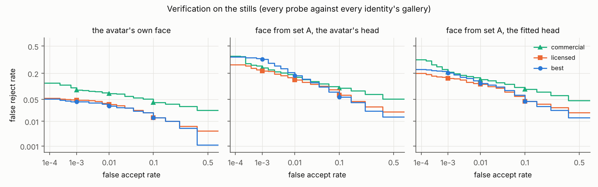
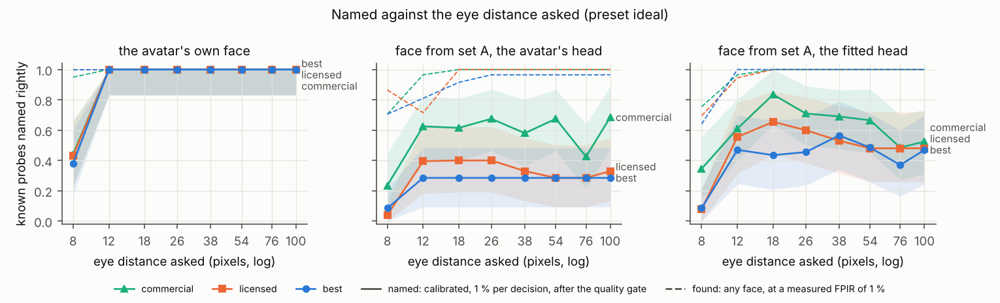
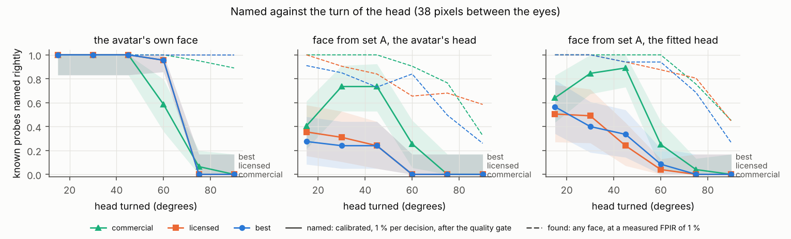
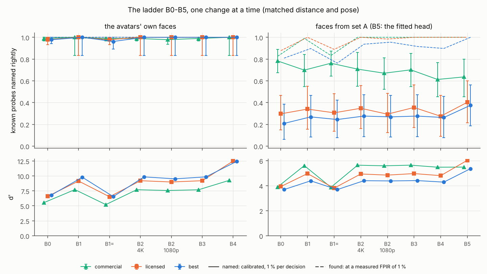

# Evaluation and first results (E1)

Step E1 of [face_recognition_focus.md](face_recognition_focus.md): the whole face recognition measured, so that every
later decision rests on numbers. The plan is section 4 of [face_recognition_sota.md](face_recognition_sota.md) and
section 4 of [high_res_faces.md](high_res_faces.md); the tools are `bifold-faces eval` (README: "Evaluating the face
recognition"), `recognition/metrics.py`, `evaluate.py`, `evalrender.py`, `evalscene.py`, `evalvideo.py`,
`margins.py` and `protocols.py`.

Measured in November 2026 in the development sandbox: four x86 cores shared with another builder, ONNX Runtime 1.31.1
on the CPU, Mesa llvmpipe, the fair's library of 20 Rocketbox avatars at 2048. Only renders of avatars appear here;
LFW's pairs and the local photos of real people were used for checks whose numbers alone are reported.

**This note grows as the measurements come in.** Sections marked *(measuring)* are not filled in yet.

## How it is measured

**Count people, not frames.** Every rate comes with the people (or tracks, or pairs) it was counted on and a 95 %
interval from a bootstrap over people: people are drawn with replacement and all their comparisons, searches or tracks
count as often as they were drawn (an impostor pair with the product of its two people's counts). A rate with no
event gets the exact bound with the people as the independent units (about 3 over the people at 95 %, the rule of
three), not a point. Operating points are counted on the scores (the threshold that lets at most the asked share
through), never interpolated, and rates the counts cannot resolve (fewer than one impostor allowed) are not reported.

**The metrics are checked** (`tests/test_metrics.py`, `tests/test_evaluate.py`) against exact hand-computed cases and
against scikit-learn's `roc_curve` (a test skipped where scikit-learn is not installed, since it is no dependency; with
scikit-learn installed beside the environment it passed, with the rest of the metrics tests); and the tests catch the
mutations the plan names (a false-accept rate off by one pair, FNIR counted per frame, a bootstrap over frames instead
of people, a manifest's condition ignored, a stale cache) and 25 more, 30 of 30.

**Who is on which side.** The identities measured are the fair's 20 avatars. The shipped calibrations were made from
87 other Rocketbox avatars (86 for the ResNet-50's and SFace's), and those wearing a face of the fair's were left out of
them; no avatar is on both sides (`protocols.sides`, recorded in every manifest). Within the measurements, an identity
is known (enrolled) or a stranger by **splits**: seeded random halvings, 20 of them for the stills, so that every
identity is measured both ways.

**An avatar as a person** (D1 of the high-resolution plan). A person's photos are renders of their avatar: **set A**
(S3's six: frontal, turned 30 and 60 degrees each way, nodded 15; 1024x768, 0.9 m, a studio light; neutral). Their
face textures are made from set A by the head-texture stages, and worn by **another avatar of their sex and age (the
carrier)**, on the carrier's own head or on the head fitted to set A (S3). Their **gallery is set B**: three windows of
their own avatar in the hall, 100 pixels between the eyes, turned -25, 0 and 25 degrees, smiling a little, under the
hall's light; no image is in both sets. A carrier's head, hair and skin show through a face it wears (measured below),
and a real person wearing their face has no enrolled carrier: so a face is never compared with its carrier's gallery,
and in the scene runs no carrier is enrolled in its own run.

## P2, rendered stills

**What was drawn** (`bifold-faces eval --build p2`: 2,760 renders, 48 minutes here with the 40 faces made from set A).
Per identity its gallery (set B) and 135 probes: 45 conditions for each of three kinds of face,

- **own**: the avatar with its own face and head, as in its gallery (the ceiling: a perfect copy of the person);
- **renders**: its face made from set A, worn by its carrier on the carrier's own head;
- **fitted**: the same face on the head fitted to set A (S3).

The conditions, all through windows of the 8K sensor 4 m from the camera: the eye distance 8, 12, 18, 26, 38, 54, 76
and 100 pixels through each camera preset (ideal, good 4K, budget 1080p: 24 conditions); and at 38 pixels through the
ideal camera, the head turned 15 to 90 degrees in steps of 15 (to the left for half the identities, to the right for
the others), nodded -30, -15, 15 and 30 degrees, lit by the side, warm and top lights instead of the hall's, its lower
face or one side of it hidden, and faces of 12, 18 and 26 pixels turned 30 and 60 degrees (21 conditions). The scene
measured what it drew: turns within 1 degree of those asked, nods within 1.2, the eye distances exact
([e1_conditions.jpg](../previews/e1_conditions.jpg) shows them for one identity).

**How it is decided.** Every probe is one live face searched against the 10 enrolled identities of each of 20 seeded
halvings: 2,700 probes, 54,000 searches, half of them by strangers. Two operating points are reported:

- **named at 1 %**: the system's decision as live, with the profile's shipped calibration at 1 % per decision (the
  single decision's accept rarity, without the per-track offset), the live quality gate and the runner-up a decade
  behind;
- **FNIR at FPIR 1e-2**: the scores alone, at the threshold that lets 1 % of these very strangers' searches through
  (what a threshold could do if it were set on the test itself; the calibration has to do it without seeing them).
  Every face found counts, also those the live gate refuses; a face not found is a miss.

Unless said, a condition's cell is 20 probes of 20 people (one each), so its 95 % interval is wide: about 17 points
from 0 or 100 %, and 20 to 45 points wide between.

**All 2,700 probes** (every condition pooled, the 90-degree turns and 8-pixel faces included, so the levels mean little
alone; percentages, 95 % intervals over people):

| Profile | Usable faces | d' | EER | TAR at FAR 1e-3 | FNIR at FPIR 1e-2 | Rank 1 | Named at 1 % | Named wrongly | Strangers named at 1 % asked | at 10 % asked |
|---|---|---|---|---|---|---|---|---|---|---|
| best (AdaFace) | 86.3 (84.7-87.8) | 2.6 (2.4-2.9) | 6.1 (4.4-7.9) | 81.3 (76.7-87.5) | 19.5 (14.6-24.2) | 98.3 | 42.8 (35.0-50.9) | 0 | 0 of 27,000 (0-2.0) | 0.02 (0-0.06) |
| licensed (ResNet-50) | 86.3 (84.7-87.8) | 2.7 (2.4-2.9) | 6.1 (4.5-7.8) | 84.1 (80.1-88.6) | 15.9 (12.5-20.2) | 98.1 | 45.5 (38.1-53.4) | 0 | 0 of 27,000 (0-2.0) | 0.02 (0-0.06) |
| commercial (SFace) | 87.3 (86.1-88.5) | 2.7 (2.4-2.9) | 8.0 (6.9-9.4) | 81.1 (74.1-85.7) | 18.8 (15.2-22.0) | 96.9 | 57.3 (49.3-65.3) | 0 | 0 of 27,000 (0-2.0) | 1.10 (0.32-2.10) |

**By kind of face** (900 probes of 20 people each):

| Face | Profile | d' | TAR at FAR 1e-3 | FNIR at FPIR 1e-2 | Named at 1 % |
|---|---|---|---|---|---|
| own | best | 4.3 (3.7-4.9) | 96 (95-97) | 4 (3-5) | 84 (83-85) |
| | licensed | 4.2 (3.7-4.8) | 95 (94-96) | 5 (4-6) | 85 (84-87) |
| | commercial | 3.7 (3.5-4.0) | 91 (88-93) | 9 (7-11) | 84 (82-87) |
| from set A, the carrier's head | best | 2.8 (2.2-3.4) | 66 (59-83) | 36 (22-43) | 17 (5-29) |
| | licensed | 2.8 (2.3-3.4) | 78 (72-86) | 23 (18-29) | 20 (9-33) |
| | commercial | 2.5 (2.2-3.0) | 75 (66-83) | 25 (17-30) | 41 (29-53) |
| from set A, the fitted head | best | 2.7 (2.3-3.3) | 80 (74-88) | 22 (15-28) | 27 (15-40) |
| | licensed | 2.7 (2.4-3.3) | 84 (80-89) | 16 (12-20) | 31 (19-43) |
| | commercial | 2.6 (2.2-3.1) | 79 (71-84) | 21 (16-27) | 47 (35-59) |

**Size and camera** (the eye distance asked; "found": FNIR at a measured 1 % at most 6 % for all three profiles; the
figures show every point with its interval: the ideal camera below, the others in
[e1/p2_ied_good_4k.png](e1/p2_ied_good_4k.png) and [e1/p2_ied_budget.png](e1/p2_ied_budget.png)):

| Camera | Own face: found from | Own face: named at 1 % from | Fitted head: found from | Fitted head: named at 1 %, 26-100 pixels |
|---|---|---|---|---|
| ideal | 8 pixels | 12 pixels (all 20, every profile) | 12 pixels | best 37-56 %, licensed 48-60 %, commercial 48-71 % |
| good 4K | 12 pixels (SFace 18) | 18 pixels (at 12: 52-57 %, SFace 90 %) | 18 pixels | best 43-52 %, licensed 44-55 %, commercial 45-74 % |
| budget 1080p | 12 pixels (SFace 18) | 26 pixels (at 18: 44-65 %, SFace 88 %) | 26 pixels (ResNet-50 18) | best 14-38 %, licensed 20-44 %, commercial 34-63 % |

**Turned, nodded, lit, hidden** (38 pixels, the ideal camera; the fitted head unless said; in % for best, licensed and
commercial, one number when the three agree):

| Condition | Usable | FNIR at FPIR 1e-2 | Named at 1 % | Own face: named at 1 % |
|---|---|---|---|---|
| frontal, the hall's light (the base) | 100, 100, 100 | 0, 0, 0 | 56, 53, 69 | 100, 100, 100 |
| turned 15 degrees | 100, 100, 100 | 0, 0, 0 | 56, 50, 64 | 100, 100, 100 |
| turned 30 | 100, 100, 100 | 0, 0, 0 | 40, 49, 84 | 100, 100, 100 |
| turned 45 | 100, 100, 95 | 6, 6, 0 | 34, 24, 89 | 100, 100, 100 |
| turned 60 | 80, 80, 40 | 6, 12, 0 | 8, 4, 25 | 96, 96, 58 |
| turned 75 | 0, 0, 10 | 31, 19, 24 | 0, 0, 4 | 0, 0, 6 |
| turned 90 | 0, 0, 0 | 74, 55, 55 | 0, 0, 0 | 0, 0, 0 |
| nodded -30 / -15 | 100 / 100 | 6 / 0 | 20, 24, 34 / 42, 62, 62 | 100, 100, 86 / 100 |
| nodded 15 / 30 | 100 / 100 | 0 / 0, 0, 10 | 32, 33, 68 / 5, 6, 50 | 100 / 91, 96, 94 |
| side light | 100 | 6, 6, 17 | 24, 22, 34 | 100, 100, 94 |
| warm light | 100 | 0 | 46, 55, 56 | 100 |
| top light | 100 | 23, 16, 10 | 18, 20, 26 | 100 |
| lower face hidden | 85, 85, 100 | 15, 15, 0 | 16, 26, 40 | 96, 96, 100 |
| one side hidden | 100 | 0, 0, 16 | 8, 8, 4 | 96, 100, 72 |
| 12 pixels, turned 30 / 60 | 100 / 70, 70, 75 | 0, 0, 22 / 16, 40, 28 | 42, 41, 67 / 4, 8, 32 | |
| 26 pixels, turned 30 / 60 | 100 / 70, 70, 50 | 6, 0, 0 / 6, 12, 0 | 47, 52, 74 / 4, 0, 50 | |

**What it shows.**

1. **A perfect copy of a face is easy; the faces made from photos are the weak link.** On their own faces every
   profile names every identity from 12 pixels between the eyes through the ideal camera, 18 through the good 4K one
   and 26 through the budget 1080p one (100 %, at least 83 % with 95 % confidence), and nearly all of them turned up
   to 45 degrees, nodded, under every light or half hidden (86-100 %; SFace 72 % with one side hidden and 58 % turned
   60 degrees). The faces made from set A and worn by another avatar are still found from 12 pixels up through the
   ideal camera (FNIR 0-6 % at a measured 1 %), but they score much lower against their own gallery. The ResNet-50's
   median score is 0.52 on the carrier's head and 0.58 on the fitted head, against 0.90 for the avatars' own faces;
   its shipped threshold for one false match in a thousand (the accept rarity at 1 % per decision with 10 people
   enrolled) is 0.56-0.58 for frontal faces of 38-100 pixels. AdaFace's fitted faces score 0.58 against 0.57-0.59,
   SFace's (T-norm) 4.6-4.7 against 4.3-4.6. So the calibrated decision names only about half of them (37-84 % at
   1 % per decision from 18 pixels up, and no better at 100 pixels than at 26): more pixels do not help a face that
   differs from the person. This is the case of the 3D people wearing known faces (README: "Known faces on the 3D
   people") and the high-resolution heads' (S2, S3) remaining gap, not the cameras': with real people in front of a
   real camera the probe is the person's own face, the first rows of the table.
2. **The shipped calibrations are much stricter than asked on these held-out avatars.** No stranger was named in
   27,000 decisions at 1 % asked (the bound with the identity pairs as units is 2 %, so 1 % itself is not resolved);
   at 10 % asked the strangers' share was 0.02 % for AdaFace and the ResNet-50 and 1.1 % (0.3-2.1) for SFace, 9 to
   500 times below the target, in every size bin (table below). The calibrations were made from 87 other avatars;
   most likely their lookalike pairs (masks, helmets, reused faces: F2's note) set the tail, and the fair's 20 are
   more distinct. What it costs: at a measured 1 % the scores alone miss 16-20 % of the known probes, while the
   calibrated decision at 1 % asked names only 43-57 % (the quality gate keeps 86-87 % of the faces; the rest is the
   calibration's strictness). On real faces the shipped thresholds are stricter than asked too (F2, and P6 below),
   which is what the margin (below) and the Mac's local check address.
3. **Size and camera.** Through the ideal camera faces are found from 8-12 pixels; the good 4K camera needs about
   half as much again (12-18 pixels) and the budget 1080p camera twice (12-26 pixels). SFace falls off first: at 8
   pixels between the eyes through the good 4K and budget cameras it misses 44 % and 70 % of the own faces at a
   measured 1 %, against 6-32 % for the other two.
4. **Turned faces.** The live quality gate keeps faces turned up to 45 degrees, and at 60 degrees 80-95 % of the
   faces SCRFD finds (best, licensed) but only 40-55 % of YuNet's (commercial); beyond 75 degrees almost none. The
   scores still recognise most turned faces at a measured 1 % (FNIR 0-12 % up to 60 degrees).
5. **Light and occlusion.** The avatars' own faces shrug off the side and top lights and half-hidden faces (named
   94-100 %, SFace 72 % with one side hidden). The faces made from photos do not: lit from the side or from above
   they are missed 6-23 % of the time at a measured 1 % (0 % under the hall's and the warm light) and named in 18-34
   %; with one side of the face hidden 4-8 %. Probably the textures made from set A carry its single studio light
   into the scene's lights, where the avatars' own textures are lit by the renderer alone.
6. **The fitted head helps the faces made from photos a little**: FNIR at a measured 1 % 22, 16 and 21 % against
   36, 23 and 25 % on the carrier's head (best, licensed, commercial), named at 1 % 27-47 % against 17-41 %; the
   intervals overlap, and the gap to the own faces stays.
7. **The carrier shows through.** A face worn on another avatar's head scores higher against the carrier's gallery
   than against its own identity's in 9-18 % of the probes on the carrier's own head and 7-9 % on the fitted head;
   with everyone enrolled none was named as the carrier at 1 % per decision (0 of 900 per head and profile). This is
   why no carrier is ever compared with the face it wears here, and why P3 never enrols one.
8. **The profiles at an equal false-alarm rate** (the commercial profile is the baseline to beat): on the own faces
   AdaFace and the ResNet-50 miss 4-5 % at a measured 1 %, SFace 9 % (7-11), and SFace falls off first with size; on
   the faces made from photos the three are within each other's intervals (16-22 % on the fitted head), AdaFace no
   better. The commercial profile names the most worn faces at 1 % asked only because its calibration is the least
   over-strict (point 2), not because it recognises them better.

**Achieved against asked, per size bin** (frontal faces; strangers' probes over the 20 halvings, named / decided,
95 % intervals with identity pairs as units):

| Bin | 10 % asked: best | licensed | commercial |
|---|---|---|---|
| 0-10 pixels | 0 / 1,800 | 0 / 1,800 | 44 / 1,783 = 2.5 % (0.1-5.3) |
| 10-14 | 0 / 2,234 | 0 / 2,234 | 59 / 2,166 = 2.7 % (0.4-5.7) |
| 14-20 | 5 / 2,215 = 0.2 % (0-0.7) | 5 / 2,215 = 0.2 % (0-0.7) | 45 / 2,063 = 2.2 % (0.3-4.9) |
| 20-28 | 0 / 2,259 | 0 / 2,259 | 19 / 1,917 = 1.0 % (0-2.3) |
| 28-40 | 0 / 6,347 | 0 / 6,347 | 67 / 7,103 = 0.9 % (0.2-2.1) |
| 40-56 | 0 / 2,947 | 0 / 2,947 | 23 / 2,117 = 1.1 % (0.1-2.7) |
| 56-80 | 0 / 1,918 | 0 / 1,918 | 5 / 2,031 = 0.2 % (0-0.8) |
| 80 and more | 0 / 2,458 | 0 / 2,458 | 8 / 2,095 = 0.4 % (0-1.2) |

At 1 % asked no bin of any profile named a stranger (upper bounds 2.3-3.7 % per bin). Known faces named as somebody
else: none, in 27,000 decisions per profile and target.

## The ladder B0-B5

**What was drawn** (`--build ladder`, `protocols.ladder`; high_res_faces.md, section 4.5): one change at a time, each
rung adding to the one before, at matched distance and pose. The person stands where the 720p view shows the face 10,
14 or 20 pixels between the eyes (the fair's faces are 11-19), frontal and turned 30 degrees, in the hall's light:

| Rung | What changes | Eye distance (pixels) |
|---|---|---|
| B0 | the 720p view, the old shading (`quality: low`, `linear: false`), 1024 textures, the avatar's own head | 10, 14, 20 |
| B1 | + the sensor's window, the ideal camera | 60, 84, 120 |
| B1= | the window at the view's own eye distance (a control: the window's pixels alone) | 10, 14, 20 |
| B2 | + the camera presets: good 4K, budget 1080p | 60, 84, 120 |
| B3 | + 2048 textures (good 4K) | 60, 84, 120 |
| B4 | + linear light and the heads' normal and specular maps | 60, 84, 120 |
| B5 | + the head fitted to set A, with the textures made on it (faces from set A only) | 60, 84, 120 |

Every rung is measured for the avatars' own faces and for the faces made from set A (B0-B4 worn on the carrier's own
head, B5 on the fitted one): 1,800 probes of 20 identities, decided as in P2 (rendered in 29 minutes here). The
gallery is the same for every rung (set B, drawn with the current renderer). Each cell: 120 probes of 20 people
(three distances, frontal and turned 30 degrees); best, licensed, commercial in that order:

| Rung | Own faces: d' | Own: named at 1 % | From set A: d' | From set A: FNIR at FPIR 1e-2 | From set A: named at 1 % |
|---|---|---|---|---|---|
| B0 | 6.8, 6.6, 5.5 | 98, 98, 99 | 3.7, 3.9, 3.9 | 19 (8-32), 12 (3-21), 17 (4-40) | 21 (6-38), 30 (15-46), 78 (67-89) |
| B1 | 9.8, 9.1, 7.7 | 100, 100, 100 | 4.4, 5.0, 5.6 | 10 (0-25), 0 (0-17), 1 (0-4) | 27 (8-46), 34 (15-55), 70 (55-84) |
| B1= | 6.5, 6.5, 5.2 | 96, 98, 99 | 3.7, 3.8, 3.9 | 24 (7-39), 11 (4-22), 17 (6-35) | 24 (8-42), 31 (14-48), 76 (64-87) |
| B2 good 4K | 9.8, 9.2, 7.7 | 100, 100, 99 | 4.4, 4.9, 5.6 | 6 (0-16), 0 (0-17), 0 (0-17) | 28 (9-47), 35 (16-56), 71 (55-86) |
| B2 budget 1080p | 9.5, 9.0, 7.6 | 100, 100, 98 | 4.4, 4.8, 5.6 | 5 (0-17), 2 (0-4), 0 (0-17) | 27 (8-46), 29 (12-49), 67 (52-81) |
| B3 | 9.8, 9.2, 7.7 | 100, 100, 99 | 4.4, 5.0, 5.6 | 8 (0-18), 0 (0-17), 0 (0-17) | 28 (9-47), 36 (17-56), 70 (55-85) |
| B4 | 12.4, 12.5, 9.3 | 100, 100, 100 | 4.3, 4.8, 5.5 | 10 (0-20), 0 (0-17), 0 (0-17) | 26 (8-46), 27 (9-47), 61 (45-77) |
| B5 | | | 5.4, 6.0, 5.5 | 0 (0-17), 0 (0-17), 0 (0-17) | 38 (19-56), 40 (21-60), 64 (45-80) |

The own faces' named shares are 96-100 % on every rung (intervals at least 83-100 %).

**What each piece buys.**

- **The sensor's windows (B0 to B1)** are the biggest step: the separation of the scores grows by about half (d'
  5.5-6.8 to 7.7-9.8 for the own faces, 3.7-3.9 to 4.4-5.6 for the faces from set A), and the faces from set A that
  the 720p view misses at a measured 1 % (12-19 %) are found (0-1 %; AdaFace 10 %). The control B1= (the window at
  the view's own eye distance) is no better than B0, so the gain is the pixels, not the path through the window.
- **The camera presets (B2)** cost little at the windows' 60-120 pixels: d' 0.0-0.3 lower through the budget camera.
- **2048 textures (B3)** change nothing measurable at these distances (they show only from about 64 pixels).
- **Linear light and the maps (B4)** raise the own faces' d' again, by a fifth to a third (to 9.3-12.5): the probes
  are then drawn as the gallery is. They do nothing for the faces from set A, probably because those textures carry
  the light of the renders they were made from.
- **The fitted head (B5)** lifts the faces from set A a little (d' 5.4-6.0 against 4.3-5.5, named 38-64 % against
  26-61 %), within the intervals.
- **The calibrated decision does not follow.** For the faces from set A every rung names about as many at 1 % per
  decision as B0 (21-78 %), the windows' bigger faces included: the shipped thresholds rise with the face's size bin
  (P2, point 1), so a bigger face that differs from the person meets a stricter test. The avatars' own faces are named
  on every rung, the 720p view included, because at the fair's distances (10-20 pixels between the eyes) and frontal
  or turned 30 degrees they are well inside what the models handle; the windows' margin shows in d', which the
  turned, smaller and occluded faces of P3 need.

## P3, rendered video *(measuring)*

**The scene** (`evalscene.parade`): the fair's hall without its crowd, eight people walking up the hall towards the
camera along fanned-out lanes, stopping 3 to 7 m from it, watching it 3 to 7 s, turning and walking back, and coming
again; four more crossing in front of them now and then. Four of the eight are known (their faces from set A on fitted
heads, worn by carriers that are strangers in that run), four are strangers with their own faces, and so are the
crossers. Four runs of 60 s at 5 frames a second, each with its own seed, enrolling the two halves of the 20
identities in turn (`protocols.halves`: no carrier is enrolled with the face it wears). With 20 avatars a carrier is
often in the same run as a stranger with its own face too, so two people may share a body and clothes: a hard case
for the tracker, not for the faces. Each run goes through the whole pipeline of the demo's `N`: the profile's person
detector (YOLO26n, or YOLOX-s for the commercial profile), the tracker, up to four windows a frame of the ideal 8K
camera, the profile's embedding budget, the calibrated decisions at 1 % per stranger track. A segment is one person
followed by one track; a face is *shown* while turned less than 45 degrees, its eyes not hidden and at least 3 pixels
apart in the view. The tracks counted are those whose face was shown at least a second (the acceptance test's);
intervals over people.

**Known people's tracks** (the shipped calibrations, the bound's offsets):

| Profile | Segments (people) | Known tracks, face shown 1 s (people) | Named within 2 s | within 5 s | at all | Named wrongly (all known tracks) |
|---|---|---|---|---|---|---|
| licensed (ResNet-50) | 232 (19) | 27 (12) | 0 % (0-26) | 0 % | 7 % (0-24) | 0 of 48 |
| commercial (SFace) | 230 (19) | 25 (12) | 0 % (0-26) | 0 % | 0 % | 0 of 54 |

**Strangers and the tracks themselves:**

| Profile | Strangers' tracks, face shown 1 s (people) | Named | Called unknown | All strangers' tracks named | Name switches | One name on two tracks | Tracks swapping people | Faces given to a wrong track |
|---|---|---|---|---|---|---|---|---|
| licensed (ResNet-50) | 24 (15) | 0 % (0-22) | 96 % (86-100) | 1 of 184 | 0 | 0 s | 52 | 36 of 3,312 |
| commercial (SFace) | 24 (15) | 0 % (0-22) | 88 % (71-100) | 0 of 176 | 0 | 0 s | 50 | 26 of 3,469 |

The one stranger's track named (licensed, run 2) was a crosser's who walked in front of a known person and took
over her track, name and all, with no face of its own shown: a track swap, not a recognition (the cautious offsets
and every other margin name it alike). Swaps are the tracker's: about 50 a profile in 4 minutes of 12 people
walking in lanes and crossing, where two people may also share a body and clothes.

## P6, LFW: the real-face gap

**Verification on F1's subset** (the first 75 mated and 75 non-mated pairs of each of LFW's ten folds: 1,500 pairs,
aligned faces of about 35 pixels between the eyes; intervals from a bootstrap over the folds, which hold disjoint
people; F1's numbers again):

| Profile | Accuracy (10-fold) | d' | EER | TAR at FAR 1e-2 |
|---|---|---|---|---|
| best (AdaFace) | 99.87 % | 8.2 (7.6-8.9) | 0.3 % (0-0.7) | 99.7 % (99.3-100) |
| licensed (ResNet-50) | 99.87 % | 7.8 (7.2-8.5) | 0.3 % (0-0.7) | 99.7 % (99.3-100) |
| commercial (SFace) | 99.47 % | 5.7 (5.4-6.1) | 0.7 % (0.3-1.1) | 99.5 % (98.5-99.9) |

**The shipped calibrations on real pairs**, per comparison (the bin of frontal faces of 28-40 pixels; 750 stranger
pairs and 750 of one person; as F2 checked SFace and the ResNet-50 on LFW's 3,000 and 1,000 pairs, now with AdaFace):

| Profile | 10 % asked: strangers above | 1 % asked | 0.1 % asked | Pairs of one person below: at 1 % per decision, 10 enrolled | at 1 % per stranger track (with the offset) |
|---|---|---|---|---|---|
| best (AdaFace, no normalisation) | 0 of 750 | 0 | 0 | 11.1 % (8.4-13.6) | 54.9 % (52.0-57.6) |
| licensed (ResNet-50, no normalisation) | 0 of 750 | 0 | 0 | 13.6 % (11.2-16.0) | 50.5 % (48.3-53.1) |
| commercial (SFace, T-norm) | 59 of 750 (7.9 %) | 7 (0.9 %) | 0 | 3.5 % (1.7-5.5) | 36.1 % (31.7-40.1) |

SFace's T-norm calibration holds on real faces as asked (F2 measured 1.4-1.6 % at 1 % on all 3,000 stranger pairs).
AdaFace's and the ResNet-50's, made without normalisation from avatars, let no real stranger pair through even at
10 % asked: avatars are more alike to each other than real people are, so raw thresholds made from them sit far up
on real faces, and the per-track offset on top misses half the pairs of one person.

**AdaFace with T-norm on LFW** (the question F2 left open): measured here on F1's subset, the pack's AdaFace
embeddings being made once for this section (40 minutes). The cohort was made as a shipped cohort is made (16 single
faces of each calibrating avatar, from F2's kept embeddings; for SFace this reproduces the shipped cohort exactly,
digest 8e9a18fca2d6149b), probe-side T-norm as live:

| Profile | d': raw | with T-norm | EER: raw | with T-norm | TAR at FAR 1e-2: raw | with T-norm |
|---|---|---|---|---|---|---|
| best (AdaFace) | 8.2 (7.6-8.9) | 7.0 (6.5-7.6) | 0.3 % (0-0.7) | 0.3 % (0-0.7) | 99.7 % (99.3-100) | 99.7 % (99.3-100) |
| licensed (ResNet-50) | 7.8 (7.2-8.5) | 6.7 (6.3-7.3) | 0.3 % (0-0.7) | 0.3 % (0-0.7) | 99.7 % (99.3-100) | 99.7 % (99.3-100) |
| commercial (SFace) | 5.7 (5.4-6.1) | 5.2 (4.9-5.5) | 0.7 % (0.3-1.1) | 0.8 % (0.3-1.2) | 99.5 % (98.5-99.9) | 99.2 % (98.1-99.9) |

T-norm with a cohort of avatars does not separate real faces better for any of the three: d' falls by a tenth to a
sixth, the EER and the TAR at FAR 1e-2 stay where they were (1,500 pairs cannot resolve 1e-3). So for AdaFace the
shipped choice (no normalisation, F2's held-out check) stands on real faces too; what T-norm does for SFace is carry
its calibration over to real faces (above), not separate them. With the pack's embeddings made, the check took about
a quarter of an hour here (most of it making F2's calibration faces and gallery again for the cohort).

**Real faces per track.** LFW's test pack has no names, but its identical images (a photo used in several pairs) and
its mated pairs say which photos show one person, and the ResNet-50 joins the rest (two photos scoring at least 0.45,
which no stranger pair of LFW's 3,000 reaches): F1's 1,500-pair subset then holds 185 people with three photos or
more and 229 with two. Each person's photos stand in for the faces a track gathers: enrolled people (half of those
with three or more photos, 20 seeded halvings) have their first photo as the gallery and the others as their track;
strangers (the other half, and everyone with two photos) have all theirs. A track is decided as live, after each new
face from the second on, on the running mean, against the target of 1 % per stranger track with the calibration's
offset (and the other margins'), the runner-up a decade behind. The pack's aligned faces count as 35 pixels between
the eyes, frontal. Over the 20 halvings: 1,840 known people's tracks (185 people) and 6,440 strangers' tracks (414
people), intervals over people:

| Profile | Margin: offset (decades) | Known tracks named | by a single face | Strangers' tracks named |
|---|---|---|---|---|
| best (AdaFace) | bound (shipped): 2.20 | 58.6 % (51.7-66.0) | 18.6 % (12.7-24.3) | 0 of 6,440 (0-0.9 %) |
| | median: 1.30 | 79.3 % (73.2-85.3) | 40.3 % (33.1-47.2) | 0 |
| | none: 0 | 95.2 % (91.6-97.9) | 73.0 % (65.7-79.4) | 0 |
| licensed (ResNet-50) | bound (shipped): 2.54 | 76.0 % (69.7-82.3) | 31.6 % (24.9-38.8) | 0 of 6,440 (0-0.9 %) |
| | median: 1.60 | 83.4 % (77.6-88.8) | 45.2 % (37.8-52.0) | 0 |
| | none: 0 | 92.4 % (88.3-96.0) | 65.8 % (57.9-72.5) | 0 |
| commercial (SFace) | bound (shipped): 2.60 | 71.4 % (64.0-77.9) | 45.2 % (37.5-52.1) | 0 of 6,440 (0-0.9 %) |
| | median: 1.06 | 91.2 % (86.8-95.3) | 66.7 % (59.2-73.1) | 0 |
| | none: 0 | 96.9 % (94.0-99.0) | 87.5 % (82.4-92.0) | 0 |

No known person's track was named as somebody else, under any margin (0 of 1,840). The point estimate's offsets
(1.30, 1.70, 1.22) name within a point of the median's.

**What it means.** On real faces the models are far better than on the faces made from photos of avatars (d' 5.7-8.2,
EER 0.3-0.7 %), and the shipped calibrations are on the safe side: no real stranger's track was named at all, even
without the per-track offset, while the offset costs a fifth to a third of the known people's tracks (named 59-76 %
instead of 92-97 %), and a single face names a person only 19-45 % of the time (the first face of a track). The
gallery here is a single photo per person and the faces are LFW's (press photos, aligned), so the levels are not the
Mac's; the direction is, and it is what P4 and P5 check there.

## The margin of the per-track offsets

**What is compared.** The calibration adds an offset to a single decision's accept rarity so that a stranger's
*track*, decided after every face, is named at the target rate at most. The shipped offsets are the smallest whose
**upper bound** (the 95th percentile of a bootstrap over identity pairs, on simulated stranger tracks of the 87
calibration avatars) stays at the target. Read from the same simulated tracks: the bootstrap's **median**, the
**point** estimate (the tracks' own share), and **no** offset. `margins.py` makes the calibration's faces again from
what `bifold-faces calibrate` kept (read only) and computes each margin's offsets with the calibration's seeds, and
their false-alarm rate per track on 60 other halvings of those avatars. What each costs in names, and whether any lets
strangers through, is measured on identities the calibration never saw: the fair's, as tracks made from the stills
(`margins.simulated_tracks`) and as the scene runs replayed (`evalscene.replayed`), and LFW's real people (P6).

**The offsets of each margin** at 1 % per stranger track (the bound comes out exactly as shipped for all three), and
the share of simulated stranger tracks named on 60 other halvings of the calibration's avatars (about 8,300-8,600
tracks of 600-760 identity pairs per model; 90 % intervals over identity pairs, as F2 reported them):

| Profile | Margin | Offset (decades) | Stranger tracks named, other halvings | Per decision |
|---|---|---|---|---|
| best (AdaFace) | bound (shipped) | 2.20 | 0.70 % (0.33-1.15) | 0.42 % |
| | median = point | 1.30 | 1.39 % (0.68-2.22) | 1.00 % |
| | none | 0 | 3.62 % (1.95-5.46) | 3.03 % |
| licensed (ResNet-50) | bound (shipped) | 2.54 | 0.52 % (0.18-0.90) | 0.27 % |
| | median | 1.60 | 1.04 % (0.48-1.67) | 0.75 % |
| | point | 1.70 | 0.98 % (0.44-1.60) | 0.69 % |
| | none | 0 | 3.01 % (1.62-4.52) | 2.70 % |
| commercial (SFace) | bound (shipped) | 2.60 | 0.61 % (0.08-1.26) | 0.40 % |
| | median | 1.06 | 1.07 % (0.37-1.93) | 0.71 % |
| | point | 1.22 | 0.94 % (0.29-1.75) | 0.65 % |
| | none | 0 | 2.48 % (1.25-3.92) | 1.58 % |

On the avatars they were made from, the median and point offsets give about the target (0.9-1.4 %), the bound about
half of it, no offset 2.5-3.6 times it. The offsets at the other targets (0.1, 0.03, 0.01, 0.003, 0.001 per track):
AdaFace bound 0.24, 1.22, 2.2, 3.0, 3.0 and point 0, 0.56, 1.3, 2.36, 3.0 (median 0, 0.52, 1.3, 2.2, 3.0); the
ResNet-50 bound 0.1, 1.28, 2.54, 3.0, 3.0 and point 0, 0.48, 1.7, 2.98, 3.0 (median 0, 0.46, 1.6, 2.94, 3.0); SFace
bound 0.12, 1.06, 2.6, 3.0, 3.0 and point 0, 0.3, 1.22, 2.56, 3.0 (median 0, 0.24, 1.06, 2.42, 3.0).

**On identities the calibration never saw** (known people's tracks named / strangers' tracks named):

| Profile | Margin | Fair, stills as tracks: fitted head (20 people) | own face | LFW, real faces (185 known, 414 strangers) | Strangers named (fair; LFW) |
|---|---|---|---|---|---|
| best (AdaFace) | bound (shipped) | 2 % (0-5) | 100 % | 58.6 % (51.7-66.0) | 0 of 200 (0-6.3 %); 0 of 6,440 (0-0.9 %) |
| | median = point | 35 % (12-56) | 100 % | 79.3 % (73.2-85.3) | 0; 0 |
| | none | 62 % (39-83) | 100 % | 95.2 % (91.6-97.9) | 0; 0 |
| licensed (ResNet-50) | bound (shipped) | 28 % (8-48) | 100 % | 76.0 % (69.7-82.3) | 0 of 200 (0-5.8 %); 0 of 6,440 (0-0.9 %) |
| | median / point | 39 % (16-60) / 39 % | 100 % | 83.4 % (77.6-88.8) / 82.9 % | 0; 0 |
| | none | 70 % (50-88) | 100 % | 92.4 % (88.3-96.0) | 0; 0 |
| commercial (SFace) | bound (shipped) | 0 % (0-17) | 43 % (23-62) | 71.4 % (64.0-77.9) | 0 of 200 (0-5.6 %); 0 of 6,440 (0-0.9 %) |
| | median / point | 14 % (2-31) / 12 % | 94 % / 90 % | 91.2 % (86.8-95.3) / 90.6 % | 0; 0 |
| | none | 78 % (60-92) | 100 % | 96.9 % (94.0-99.0) | 0; 0 |

The fair's tracks: each identity's faces of one kind seen in all of P2's sweeps through the ideal camera (sizes 8-100
pixels, turns, nods, lights, occluders), in a random order, decided after each face as live, 20 halvings (200 known
and 200 stranger tracks per margin; the per-camera size sweeps give the same picture). No known person's track was
named as somebody else under any margin, on the fair's identities or on LFW's.

**P3's scene runs replayed per margin** *(measuring: the best profile's runs to come)*. The runs decided with the
bound (the shipped offsets then); each segment's decisions replayed with the other margins' offsets (faithful for
looser margins, `evalscene.replay`). Known people's tracks whose face was shown a second (25 of 12 people for the
commercial profile, 27 of 12 for the licensed), strangers' likewise (25 of 15 people) and all strangers' tracks:

| Profile | Margin (offset) | Known: named within 2 s | within 5 s | at all | Strangers named: shown a second | all strangers' tracks |
|---|---|---|---|---|---|---|
| commercial (SFace) | bound (2.60) | 0 | 0 | 0 | 0 | 0 of 176 |
| | point (1.22) | 1 (4 %) | 3 (12 %) | 5 (20 %) | 0 | 0 |
| | median (1.06) | 1 | 5 | 6 (24 %) | 0 | 3 |
| | none | 11 (44 %) | 19 (76 %) | 22 (88 %) | 0 | 10 (5.7 %) |
| licensed (ResNet-50) | bound (2.54) | 0 | 0 | 2 (7 %) | 0 | 1 of 184 (the swap) |
| | point (1.70) | 0 | 2 | 2 | 0 | 1 (the swap) |
| | median (1.60) | 0 | 2 | 2 | 0 | 1 (the swap) |
| | none | 3 (11 %) | 5 | 10 (37 %) | 0 | 6 (3.3 %) |

No known person was named wrongly under any margin. The point estimate named no stranger the bound did not (the one
is the licensed run's swap); the median, looser for SFace, named three strangers' brief tracks (faces never shown a
second) and no offset ten, so in the scene runs the point estimate is the loosest margin that adds no false alarm.
What all margins show: the faces made from photos are rarely named in the fair at 1 % per track, by any margin but
none (P2: they score at the thresholds).

**Recommendation: make the point estimate the default margin.** Its offsets keep a stranger's track at the target on
the very avatars the calibration was made from (0.9-1.4 % per track at 1 % asked, within the acceptance test's factor
of 2; the bound gives 0.5-0.7 %), and on every held-out set here (the fair's avatars, LFW's real people, the scene
runs) they let no stranger's track through, exactly as the bound does, while naming far more of the known people: on
real faces 79-91 % of the known tracks instead of 59-76 % (with no offset 92-97 %), on the fair's faces made from
photos 12-39 % instead of 0-28 %. The bound buys a factor of 2 against lookalike pairs like the calibration avatars'
(helmets, masks, reused faces), a protection no held-out identity needed here; no offset at all is too loose for such
pairs (2.5-3.6 % per track). The bootstrap's median names about as many (within a few points). A wrong name is the
worst outcome: none was measured under any margin, but with 20 held-out avatars and 414 real strangers the strangers'
upper bounds are 0.9-6 %, so the claim that the looser margin keeps 1 % rests on the calibration avatars' own
halvings, where it measured the target. Shipping it changes F2's calibrations (their `track` offsets, listed above per
target), so it is proposed here, not made: `bifold-faces calibrate` would take the margin as an option, and its
per-track check would then show about the target instead of half of it.

## The acceptance test *(measuring)*

**The test** (`docs/research/face_recognition_sota.md`, section 4.4; `metrics.acceptance`): at least 95 % of the
enrolled people's tracks whose face was shown for a second (turned less than 45 degrees) named correctly within 2
seconds; a false-alarm rate per stranger track of 1 %, achieved within a factor of 2 either way; no identity on two
tracks at once. The verdict also says whether each measured share meets its criterion with its interval (a few dozen
people cannot show 95 % or 1 % with confidence). It runs as `bifold-faces eval MANIFEST --acceptance` on scene runs
here (exit status 1 when a profile fails) and on P5's labelled recordings on the Mac (`--review VIDEO --acceptance`).

## Cost, measured here *(measuring)*

On this sandbox (four x86 cores shared with another builder; CPU only, ONNX Runtime):

- **embedding** P2's faces in batches of 16: SFace 2,698 in 21 s (8 ms a face), the ResNet-50 2,695 in 278 s (0.10 s),
  AdaFace 2,695 in about 2,100 s (0.8 s, with another builder's job running);
- **rendering** P2's 2,700 probes with their 40 faces made from set A: 2,881 s (1.07 s a still);
- **scoring** P2 from the caches with 1,000 bootstrap draws per measure and condition: 69 s for the three profiles;
  LFW's subset with the real-face tracks and every margin, 14 s;
- **embedding** LFW's 3,000 aligned faces (in batches of 32, under load): AdaFace about 39 minutes (0.8 s a face),
  the ResNet-50 9 (0.18 s), SFace 44 s (15 ms).

## Real people on the Mac (P4, P5)

The protocols and the tools are in the README ("Real people on the Mac"): a folder of consenting people's photos (P4:
`bifold-faces eval --build photos`), recorded sessions reviewed and labelled by hand (P5: `--record`, `--review`), and
what to report. A smoke test here on the local test photos (6 people, 4 of them enrolled from one photo each; aggregate
numbers only, nothing made from them kept): every known probe was named rightly at 1 % per decision by all three
profiles, also shrunk to an eighth of the photo, and no stranger was named; with 6 people the 95 % intervals are
40-100 % and 0-71 %, so this shows the tools work, not how well.

**What the measurements here say to do there.**

1. **Measure first, with consenting people.** P4 with at least 20 enrolled people (enrolment photos from one session,
   probes from other days, lights and poses) and as many consenting people who are not enrolled, then P5's recorded
   sessions with `--acceptance`. The numbers to report are listed in the README; nothing made from the photos or
   recordings leaves the Mac.
2. **Expect the shipped calibrations to be strict on real faces.** On LFW they let no stranger's track through even
   without the per-track offset, while the shipped offsets leave a quarter to two fifths of the known people's tracks
   unnamed (P6). If P4's and P5's strangers show the same (no stranger named, many known people not named), the point
   estimate's offsets (the recommended margin) are the first step: on LFW they named 79-91 % of the known tracks with
   no stranger named.
3. **Then a local calibration from the consenting people.** The calibration's curves are per face-size and turn bin;
   each pair of consenting people is a stranger pair, so 46 people give the 1,000 pairs needed to see a false-match
   rate of 1 in 1,000 per comparison (the single decision's threshold at 1 % with 10 people enrolled), and P5's
   tracks give the per-track check. `bifold-faces calibrate` makes calibrations from renders of avatars only; a
   calibration from a folder of consenting people's photos (the avatars' curves kept where the photos do not reach)
   is the tool to add, proposed here. Until then P4's strangers check a calibration rather than make one.
4. **The speed.** The acceptance test asks for a name within 2 seconds; how the best profile does with the embedding
   rate a Mac would give it is the P3 run at 10 embeddings a second (below). *(measuring)*
